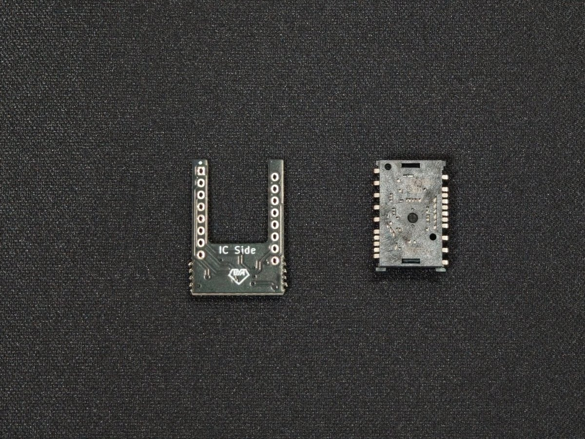
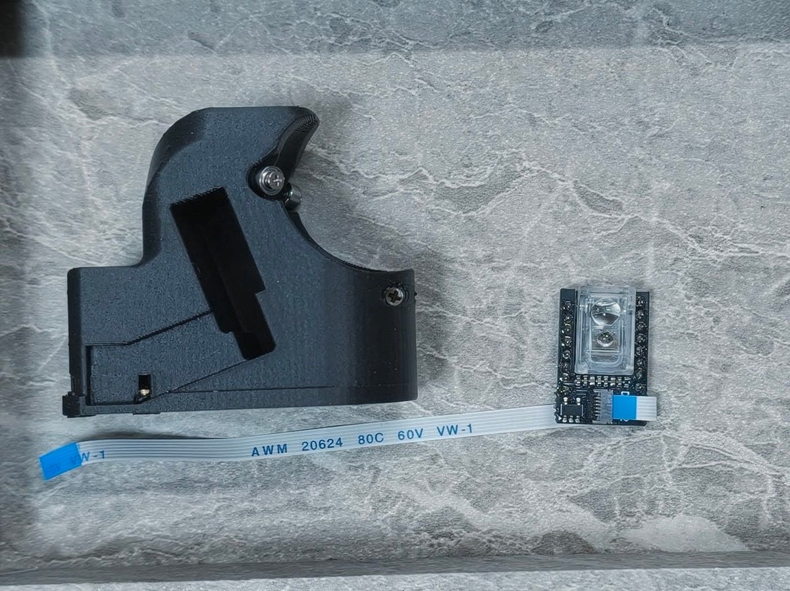
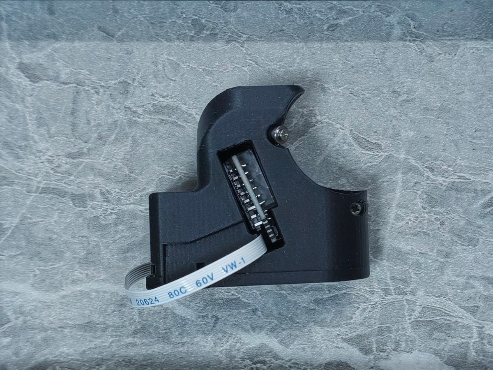
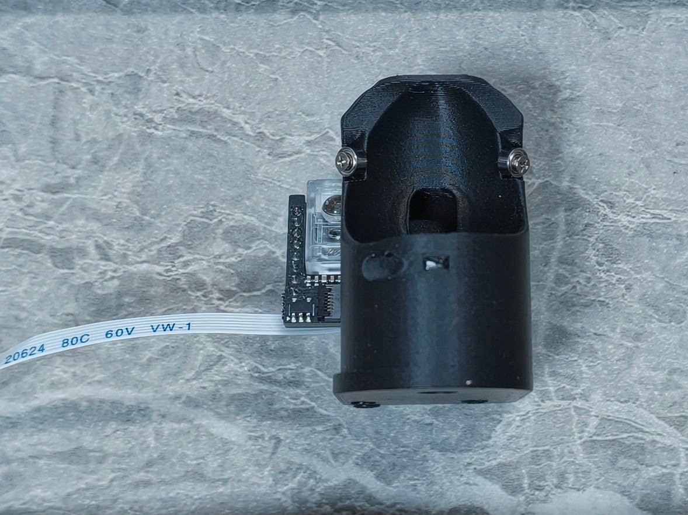
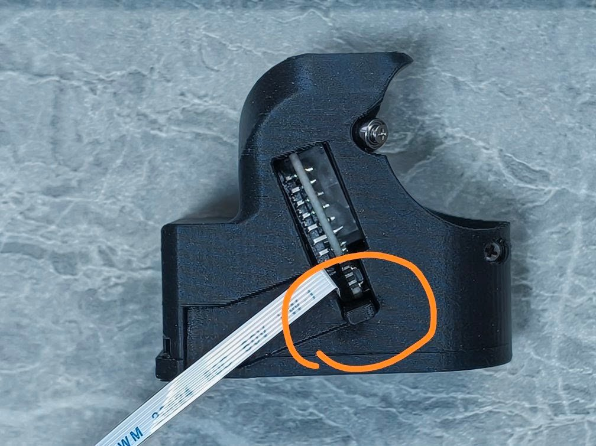
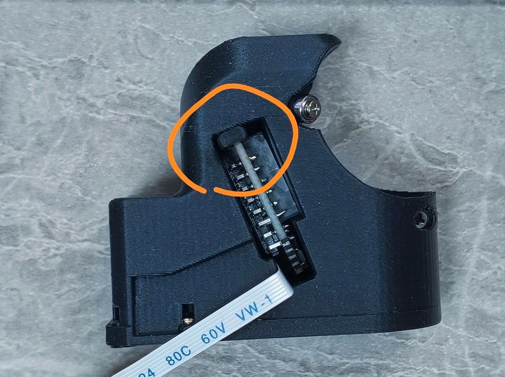
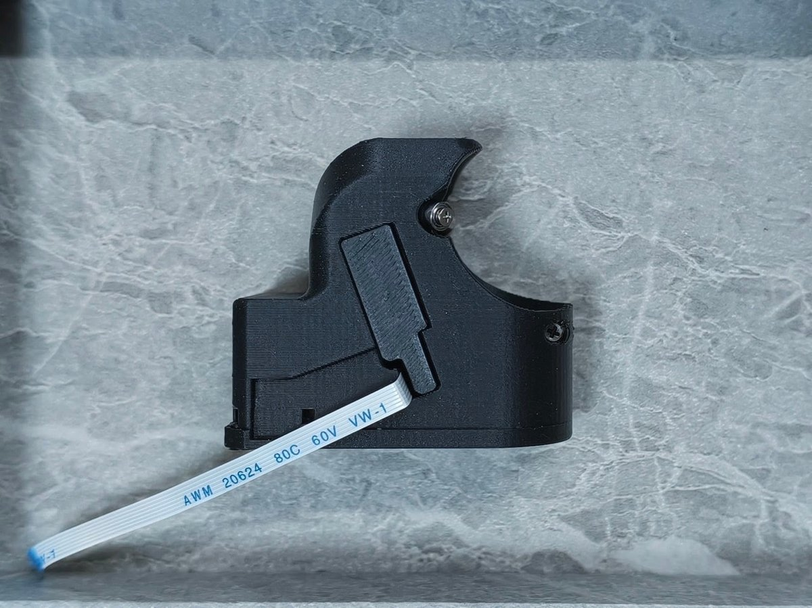

[DYA2 向け 25mm トラックボールホルダー](https://cormoran707.booth.pm/items/8973349)のビルドガイドです。DYA2 の 34mm トラックボールホルダーを交換して使用します。

:::caution
**PMW3610 センサーのはんだ付けが必要です。** DYA2 本体に付属するセンサー基板とは形状が異なるため、このセットに付属する基板を使用してください。
:::

## 用意するもの

### キットの内容物

| 部品 | 数量・備考 |
| --- | --- |
| 3D プリント製トラックボールホルダー | 黒色 |
| 3D プリント製固定具 | 2種類（小さな位置調整用固定具・カバー） |
| ベアリング | 内径 1.5mm、外径 4mm、幅 2mm × 3 |
| M1.4 5mm ねじ | 3本、ベアリング固定用 |
| M2 用ヒートインサート | 3個 |
| PMW3610 IC・レンズ | 1セット |
| PMW3610 用基板 | 1枚、DYA Dash で使用している形状 |
| 6pin・0.5mm ピッチ FFC ケーブル | 予備 |

ベアリング・M1.4 ねじ・ヒートインサートは取り付け済みの場合があります。写真では取り付け済みのホルダーを使用しています。

### 別途用意するもの

- DYA2 本体
- **直径 25mm のトラックボール**（下の対応表を確認してください）
- DYA2 のホルダー固定用 **M2 4mm ねじ × 3本**（34mm ホルダーから交換する場合は取り外したものを使用）
- はんだごて・はんだ・こて台など、はんだ付けに必要な道具
- ねじに合う精密プラスドライバー
- ピンセット

## 組み立て前の準備

作業前に DYA2 の電源を切り、USB ケーブルを外してください。組み立て済みの DYA2 から交換する場合は、ボールとトップケースを外し、FFC ケーブルの接続とホルダーの固定ねじにアクセスできる状態にします。ケーブルを引っ張らないように注意し、34mm ホルダーを取り外します。

ベアリングが未取り付けの場合は、ホルダーの3か所の支持位置に M1.4 5mm ねじで取り付け、各ベアリングが回ることを確認します。ヒートインサートが未取り付けの場合は、ホルダー底面の3か所に取り付けてから本体に固定します。

## 1. PMW3610 をはんだ付けする

基板の **「IC Side」と書かれた面にセンサーを載せます**。下の写真のように、基板の開口部を上にして置いたとき、センサーの角にある丸い目印が左上に来る向きに合わせてください。基板の左上には四角いランドがあります。

向きを確認してセンサーのピンを基板の穴に通し、反対側からはんだ付けします。センサーが傾かないように固定し、隣り合うピンがはんだでつながっていないことを確認してください。

センサーの保護シートを剥がし、レンズを取り付けます。レンズの突起をセンサーの穴に合わせ、浮きや傾きがないことを確認してください。センサーの開口部やレンズに指で触れたり、汚れを付けたりしないようにします。

## 2. FFC ケーブルを接続する

センサー基板のコネクタのロックを開き、6pin FFC ケーブルを奥までまっすぐ差し込んでロックします。下の写真で、青い補強板の向きとケーブルの取り回しを確認してください。

:::caution
FFC ケーブルの抜き差しは、必ずコネクタのロックを開いてから行ってください。ケーブルを強く折り曲げたり、引っ張ったりすると断線することがあります。
:::

## 3. センサー基板をホルダーに入れる

ホルダー側面の開口部に、**レンズがボール側（ホルダー内側）を向くように**基板を入れます。FFC コネクタが下側に来る向きです。

ボールを載せる側から見た向きは次のとおりです。写真は向きが分かるように基板を途中まで入れた状態です。レンズが内側を向いていることを確認し、ケーブルを挟み込まないように収めてください。

## 4. ボールに合わせて固定具の位置を選ぶ

小さな固定具をセンサーの**上側または下側**に入れて位置を調整します。ここでの上下は、下の写真の向きで、FFC コネクタ側が「下」、その反対側が「上」です。

次の表は[商品ページ](https://cormoran707.booth.pm/items/8973349)で反応を確認している組み合わせです。

<table>
  <thead>
    <tr><th scope="col">固定具の位置</th><th scope="col">ボール</th><th scope="col">注意点</th></tr>
  </thead>
  <tbody>
    <tr>
      <th rowspan="3" scope="rowgroup">センサーの下側</th>
      <td>エレコム 赤玉 M-B25RD</td>
      <td rowspan="2">個体差や使用条件によって反応が安定しない場合があります</td>
    </tr>
    <tr><td>ペリックス 赤玉 PERIPRO-305GRD</td></tr>
    <tr>
      <td>Keychron Nape Pro 25mm ボール（白・青・シルバー）</td>
      <td><strong>黒は動きません</strong></td>
    </tr>
  </tbody>
  <tbody>
    <tr>
      <th rowspan="2" scope="rowgroup">センサーの上側</th>
      <td>染色 POM 球</td>
      <td>黄色は反応せず、黒は反応が悪い場合があります</td>
    </tr>
    <tr>
      <td>白い POM 球</td>
      <td>個体差や使用条件によって反応が安定しない場合があります</td>
    </tr>
  </tbody>
</table>

### 下側に取り付ける場合

写真のオレンジ色の丸で示した、FFC コネクタ側の隙間に小さな固定具を入れます。

### 上側に取り付ける場合

写真のオレンジ色の丸で示した、センサー上端とホルダーの間に小さな固定具を入れます。

## 5. カバーを取り付ける

センサー基板と小さな固定具が収まっていることを確認し、大きな固定具（カバー）を側面の開口部にはめ込みます。FFC ケーブルは写真のようにカバー下側から出してください。

カバーが浮く場合は無理に押し込まず、基板・固定具の位置やケーブルの挟み込みを確認します。

## 6. DYA2 に取り付ける

1. ホルダーを DYA2 のボトムケースに載せ、底面から **M2 4mm ねじ × 3本**で仮止めします。
2. FFC ケーブルを DYA2 のトラックボール用コネクタに接続します。ロックを開いてから奥まで差し込み、ロックを閉じてください。
3. ケーブルを挟まないようにトップケースを戻します。
4. 25mm のボールを載せ、ホルダーを左右に動かして好みの位置に合わせます。標準の 34mm ホルダーと同様、数 mm 程度の位置調整ができます。
5. ボールが周囲に擦れずに回ることを確認し、固定ねじを締めます。締めすぎに注意してください。

本体側の取り付けやケースの組み立ては、[DYA2 本体の組み立てガイド](/dya2-keyboard/build-guide/v1/assembly/)も参照してください。

## ケースデータ

ホルダーのケースデータは[Google Drive](https://drive.google.com/drive/folders/1RoO5yyYlsVLcjxOQu39RfRmcU64asvkR?usp=sharing)で公開しています。
